# Synthetic 360° Space-Object Dataset (Equirectangular)

A synthetic dataset of space objects rendered as 360° equirectangular (ERP) panoramas, for training omnidirectional perception models — semantic segmentation, depth estimation, classification, and 6-DoF pose. It is modeled on perspective spacecraft datasets (e.g. SPEED, URSO) but extended to the equirectangular domain for a 360°/omnidirectional sensor application.

> Auto-generated by `make_dataset_docs.py` on 2026-06-18. Re-run after any re-render.

## At a glance

- **Total images:** 49,998
- **Classes:** 13
- **Resolution:** 1024×512
- **Renderer:** OPTIX (True), Blender 5.1.2
- **Distinct models:** 208 across 13 classes
- **Depth coverage:** 49,998/49,998

## How it was made

Each frame is rendered in Blender (Cycles, GPU/OptiX) through a Python (bpy) pipeline. The camera is a panoramic equirectangular camera capturing the full sphere. Every frame places one labeled subject in a fully random 3-D orientation (logged as a quaternion) at a random position on the sphere. Backgrounds mix a procedural starfield of varied density, a randomly chosen planet or moon backdrop (Earth, Mars, Jupiter, Saturn, Venus, Moon), and an occasional pure-black deep-space frame. Lighting uses a sun aimed at the subject plus fill and rim lights; backdrops receive a dedicated sun so their camera-facing side is lit. Depth is written through the compositor as a single-layer 32-bit OpenEXR. Cubesats are partly procedurally generated (random 1U/2U/3U/6U bodies, deployable solar wings, antennas) to compensate for the small number of real cubesat models.

## Assets & attribution

3-D models are from NASA's 3D Resources collection; planet and moon surfaces use NASA imagery. Procedural generators (cubesat, asteroid, textured sphere) supplement the real models. NASA-produced media is generally free to use with attribution and without implying NASA endorsement, but some items are third-party and carry their own terms — verify the license of each model against NASA's official media-usage guidelines and the NASA 3D Resources terms before redistribution, and cite NASA as the source of the underlying 3-D models.

## Classes & label palette

| Class | Subject frames | Models | RGB | Hex |
|---|--:|--:|---|---|
| earth_obs_satellite | 3,846 | 51 | (220, 50, 50) | #dc3232 |
| space_telescope | 3,846 | 26 | (50, 200, 80) | #32c850 |
| space_station | 3,846 | 10 | (50, 90, 220) | #325adc |
| deep_space_probe | 3,846 | 32 | (220, 200, 50) | #dcc832 |
| mars_mission | 3,846 | 17 | (200, 100, 30) | #c8641e |
| comm_satellite | 3,846 | 8 | (160, 60, 200) | #a03cc8 |
| cubesat | 3,846 | 4 | (60, 200, 200) | #3cc8c8 |
| astronaut_eva | 3,846 | 14 | (240, 130, 200) | #f082c8 |
| solar_heliophysics | 3,846 | 17 | (250, 160, 40) | #faa028 |
| rocket_launch_vehicle | 3,846 | 25 | (120, 80, 220) | #7850dc |
| planet | 3,846 | 1 | (30, 120, 255) | #1e78ff |
| moon | 3,846 | 1 | (190, 190, 190) | #bebebe |
| asteroid | 3,846 | 2 | (120, 100, 80) | #786450 |

_Background (class 0) is black (0,0,0)._

## Distribution & balance

- Earth/planet backdrop: 25.4%
- Near-pole: 6.1%
- Pure-black background: 0.0%
- >1 labeled object: 25.4%

## Figures

**Subject frames per class. A flat profile confirms class balance.**

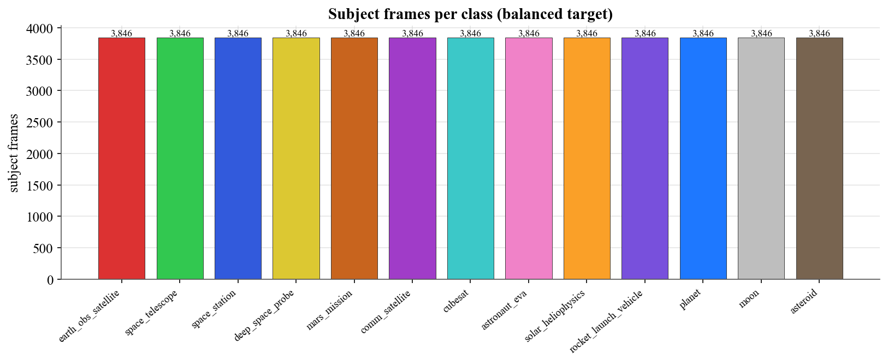

**Total occurrences per class. Planet/moon exceed their subject counts because they also appear as backdrops — relevant for per-pixel class weighting.**

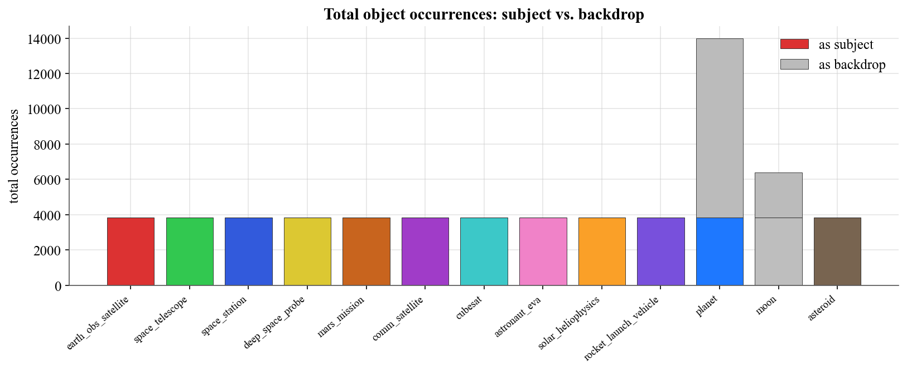

**Distinct underlying 3-D models per class. Low values (e.g. comm_satellite) indicate limited shape variety.**

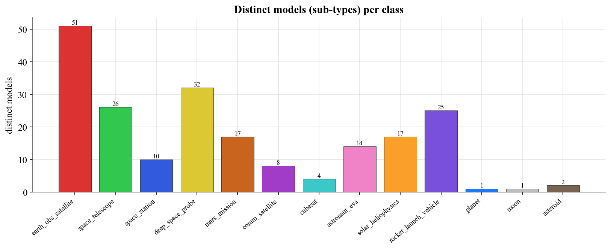

**Share of frames carrying each attribute flag.**

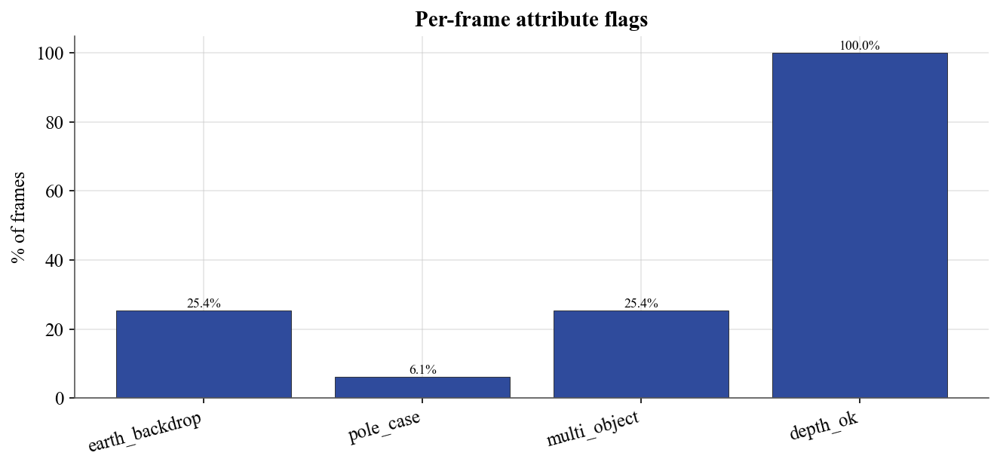

**Number of labeled objects per frame (1 = subject only, 2 = subject + backdrop).**

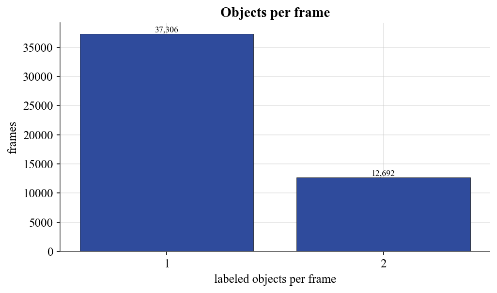

**Apparent angular size of the subject across the dataset.**

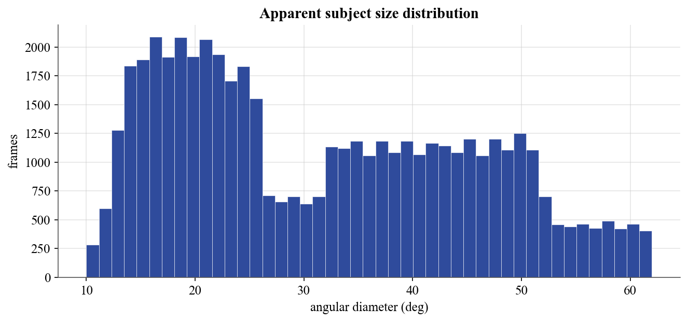

**Per-class apparent size. Celestial classes appear larger than craft.**

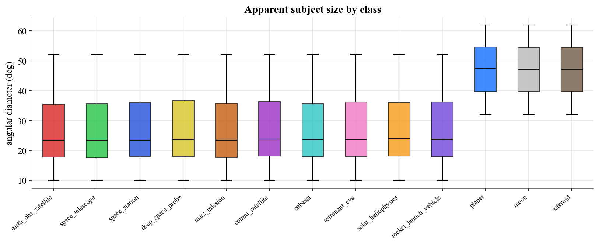

**Distance from camera to subject.**

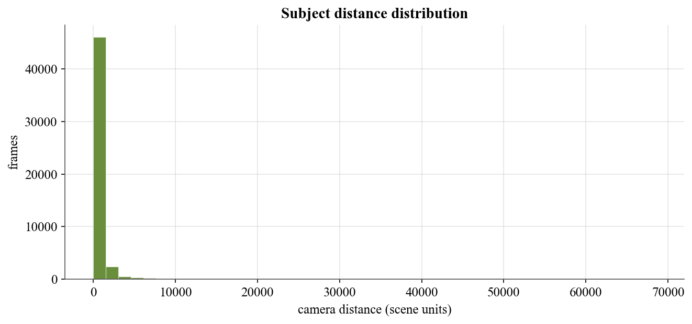

**Subject azimuth distribution (flat = even 360° coverage).**

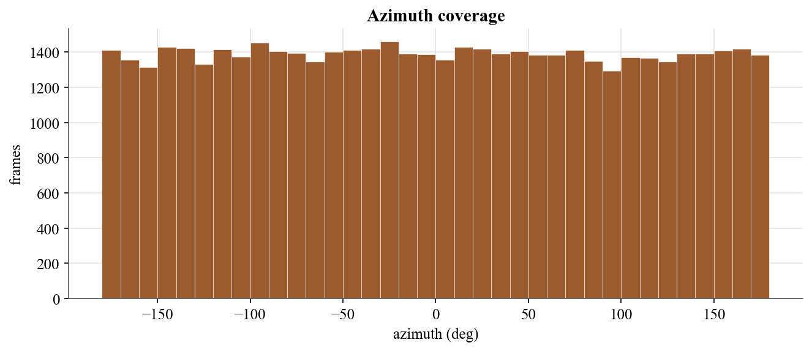

**Subject elevation distribution; the tails are the deliberate near-pole frames.**

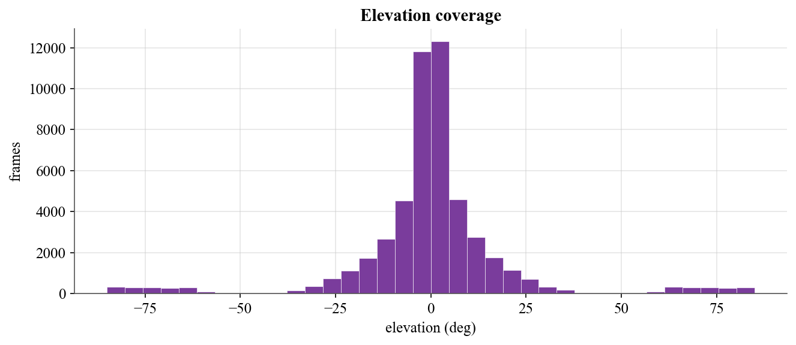

**Joint azimuth–elevation density. Uniform fill = good spherical coverage.**

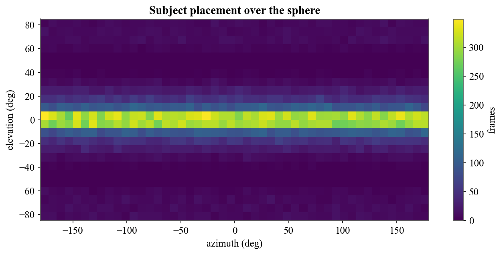

**Which planet/moon textures appear as backdrops.**

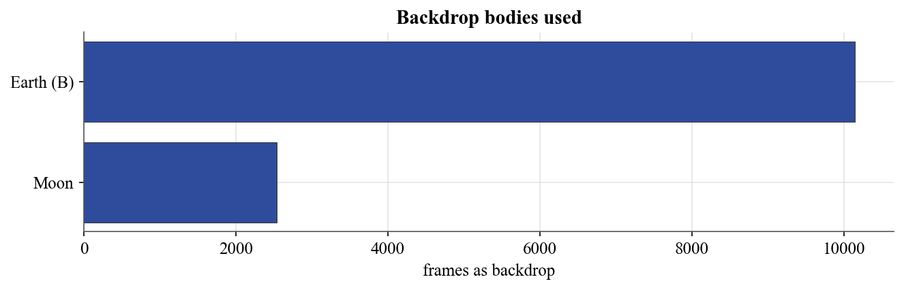

**Per-model frame counts within planet.**

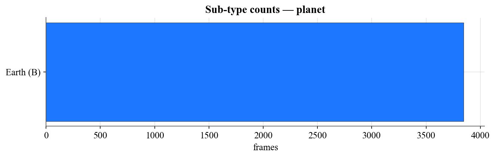

**Per-model frame counts within moon.**

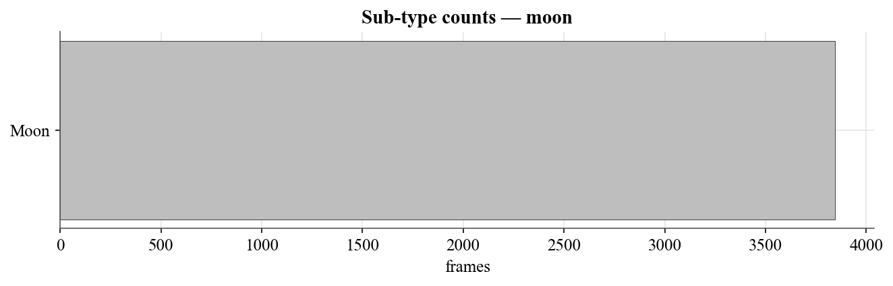

**Per-model frame counts within asteroid.**

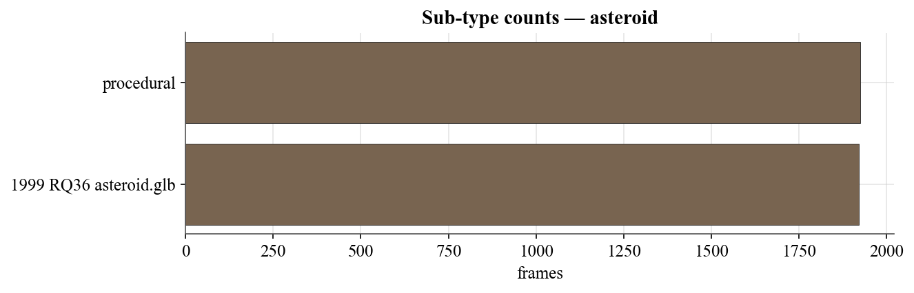

## Comparison with existing space datasets

Public spacecraft-vision datasets are overwhelmingly perspective (pinhole), and most target a single spacecraft for pose estimation (SPEED, SPEED+, URSO, SwissCube); SPARK is the main multi-class recognition set. This dataset differs primarily in projection — it is equirectangular 360°, intended for omnidirectional sensors — and in breadth, combining semantic segmentation, depth, classification, and 6-DoF pose over many categories drawn from roughly two hundred distinct NASA models. Unlike SPEED and SPEED+, it contains no real or hardware-in-the-loop imagery; it is purely synthetic, which is its main trade-off against those benchmarks.

| Dataset | Year | Group (authors) | Projection | Targets / classes | Images | Ground truth | Task |
|---|---|---|---|---|---|---|---|
| SPEED | 2019 | Stanford SLAB & ESA ACT (Sharma, Park, D'Amico) | Perspective | 1 (Tango) | 15,300 (15,000 synthetic + 300 real) | RGB, pose | Pose estimation |
| SPEED+ | 2021 | Stanford SLAB & ESA ACT (Park, Märtens, Lecuyer, Izzo, D'Amico) | Perspective | 1 (Tango) | 59,960 synthetic + 9,531 HIL real | RGB, pose, masks | Pose / domain gap |
| URSO | 2020 | Surrey Space Centre (Proença, Gao) | Perspective | 2 (Soyuz, Dragon) | ~15,000 (5,000 per set) | RGB, depth, pose | Pose estimation |
| SwissCube | 2021 | EPFL CVLab (Hu, Speierer, Jakob, Fua, Salzmann) | Perspective | 1 (SwissCube) | 50,000 (40k/10k) | RGB, 6-DoF pose | Wide-depth-range 6D pose |
| SPARK | 2021 | Univ. of Luxembourg SnT & LMO (Musallam et al.) | Perspective | 11 classes (10 spacecraft + 1 debris) | ~150,000 RGB + 150,000 depth | RGB, depth, class, bbox | Classification & detection |
| **This dataset** | 2026 | — | Equirectangular 360° | 13 classes (~208 NASA models) | 49,998 | RGB, semantic mask, depth (EXR), class, 6-DoF pose | Segmentation, depth, classification, pose |

**References**

- S. Sharma, T. H. Park, S. D'Amico. Spacecraft Pose Estimation Dataset (SPEED). Stanford Digital Repository / ESA Kelvins SPEC2019, 2019.
- T. H. Park, M. Märtens, G. Lecuyer, D. Izzo, S. D'Amico. SPEED+: Next-Generation Dataset for Spacecraft Pose Estimation across Domain Gap. IEEE Aerospace Conference, 2022.
- P. F. Proença, Y. Gao. Deep Learning for Spacecraft Pose Estimation from Photorealistic Rendering (URSO). IEEE ICRA, 2020.
- Y. Hu, S. Speierer, W. Jakob, P. Fua, M. Salzmann. Wide-Depth-Range 6D Object Pose Estimation in Space (SwissCube). IEEE/CVF CVPR, 2021.
- M. A. Musallam, K. Al Ismaeil, O. Oyedotun, M. D. Perez, M. Poucet, D. Aouada. SPARK: SPAcecraft Recognition leveraging Knowledge of Space Environment. IEEE ICIP Grand Challenge, 2021.

## Known limitations

- Thin model diversity in a few classes (e.g. comm_satellite, space_station): frame counts are balanced, but the number of distinct underlying models is small, so shape variety is limited there. Cubesats are supplemented procedurally.
- Planet and moon are over-represented at the pixel level because they appear as backdrops as well as subjects. Frame-level classification is balanced; for per-pixel segmentation use class-weighted or focal loss.
- Some sub-types are over-represented within a class due to occasional model-import fall-through. Negligible for class-level tasks; relevant only if sub-types are used as labels.
- ERP distortion near the poles and the wrap-around seam is present by design — it reflects what a real 360° sensor sees and is part of the intended challenge.
- Lighting is deliberately softened (fill + rim + faint stars) for trainability; real space imagery has harsher contrast and often no visible stars.
